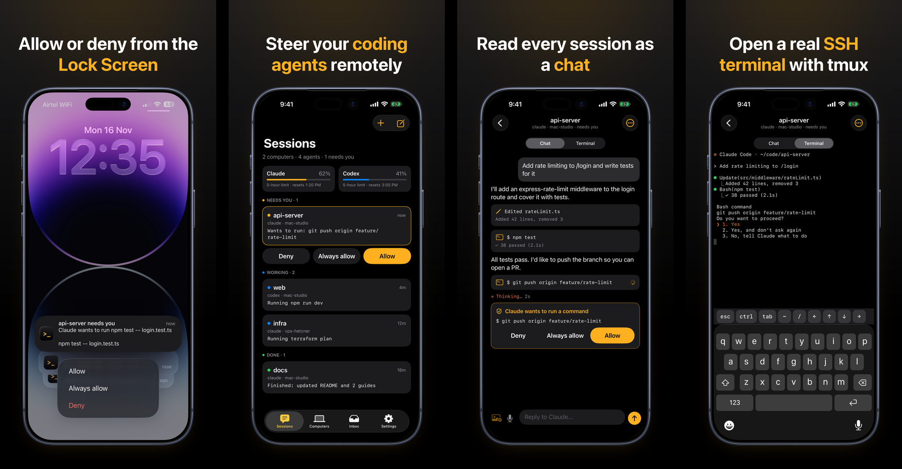
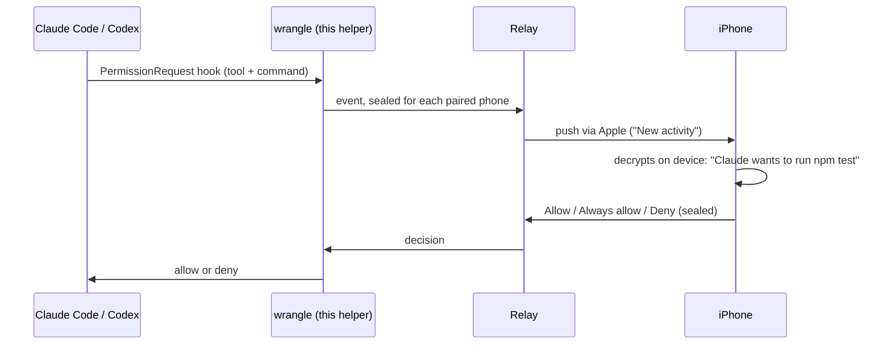
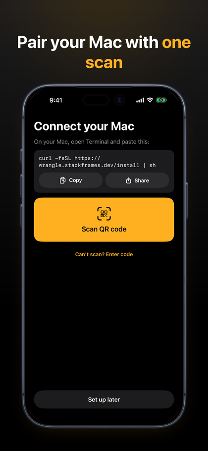

# Wrangle helper

The program that runs on your Mac or Linux machine for [Wrangle](https://wrangle.stackframes.dev), the iPhone app
that lets you approve Claude Code and Codex requests from your Lock Screen.



The iPhone app is closed source. This helper is open so you can read exactly what it does on your computer and what
it sends over the network.

## How an approval reaches your phone



If nobody answers in time, the hook returns nothing and the agent asks in the terminal as usual. Answering in the
terminal first also works: the phone's alert is withdrawn.

## What it does

- **Adds hooks to Claude Code and Codex.** When an agent asks for permission, finishes or gets stuck, the hook hands
  the event to the helper. `wrangle uninstall` removes every hook it added and leaves the rest of your config alone.
- **Sends each event to your phone, encrypted.** The helper keeps one outbound WebSocket to the relay and seals every
  event separately for each paired phone. Your decision (Allow, Deny) comes back the same way.
- **Adds your phone's SSH key** to `~/.ssh/authorized_keys` when you pair, marked `wrangle:<device id>`, so the app
  can open a terminal and a chat view over SSH. Removing the phone removes the key.
- **Runs in the background** as a launchd agent on macOS or a systemd user unit on Linux.

## What leaves your computer

| Goes to the relay | Readable by the relay? |
|---|---|
| Event text: title, body, the command or tool input, project name, folder | No. Sealed with ChaCha20-Poly1305 using a key only your phone and this computer hold |
| Your decision from the phone | No. Sealed the same way |
| Agent usage figures | No. Sealed the same way |
| Event kind (approval, done, waiting…), agent name, timestamps, and a thread id (a short SHA-256 hash of the agent session id, so one session's events group together) | Yes. The relay needs them to route and expire events |
| The computer's name and the phone's name, sent once when you pair | Yes |

Push notifications go through Apple. Their visible text is a fixed "New activity"; the phone decrypts the real text
on the device. The one exception is the relay's own notice when a free plan's monthly alerts run out, which says
just that. The terminal and the chat view connect straight from the phone to your computer over SSH and never
pass through the relay.

The full wire format, keys and pairing steps are in [protocol/README.md](protocol/README.md), with test vectors in
`protocol/vectors.json`.

## Requirements

- macOS, or Linux on amd64 or arm64
- tmux, for the terminal and chat view
- Go 1.27 or newer, to build it yourself

## Build and run

```bash
go install github.com/chetanverma16/wrangle@latest
wrangle setup
```

`wrangle setup` installs the hooks and the background service, then shows a QR code to scan with the Wrangle app.
Both sides then show the same security words, so you can check that nothing sits in between.



| Command | What it does |
|---|---|
| `wrangle setup` | Pair a phone and install everything |
| `wrangle doctor` | Check the setup and report what is wrong |
| `wrangle remove-device [name]` | Unpair a phone and remove its SSH key |
| `wrangle install` / `uninstall` | Add or remove the hooks and the service |
| `wrangle config keep-awake on\|off` | Stop the Mac from sleeping while it is on power, so agents keep running |
| `wrangle version` | Print the version |

## Troubleshooting

Run `wrangle doctor`. Each failed check prints its fix:

```text
$ wrangle doctor
✓ tmux  /opt/homebrew/bin/tmux
✓ Remote Login is on
✓ Tailscale SSH is off (or Tailscale isn't installed)
✓ 3 addresses for your iPhone
✓ Wrangle server reachable
✓ Background service running
✓ Background service connected to the Wrangle server
✓ Phone approvals for Claude Code are on
! Another Claude Code hook approves some commands itself (~/.claude/hooks/auto-approve.sh). Claude won't ask about those, so they won't reach your iPhone. Everything else still does.
✓ Terminal key for “Alex's iPhone” is in ~/.ssh/authorized_keys
```

Some commands never reach your phone? Claude Code only asks for permission when nothing else has decided. A
`PreToolUse` hook that returns `"permissionDecision": "allow"` approves the call before Claude asks, so Wrangle never
sees it. `doctor` lists any such hook.

## Tests

```bash
go test ./...
```

## License

MIT. See [LICENSE](LICENSE).
